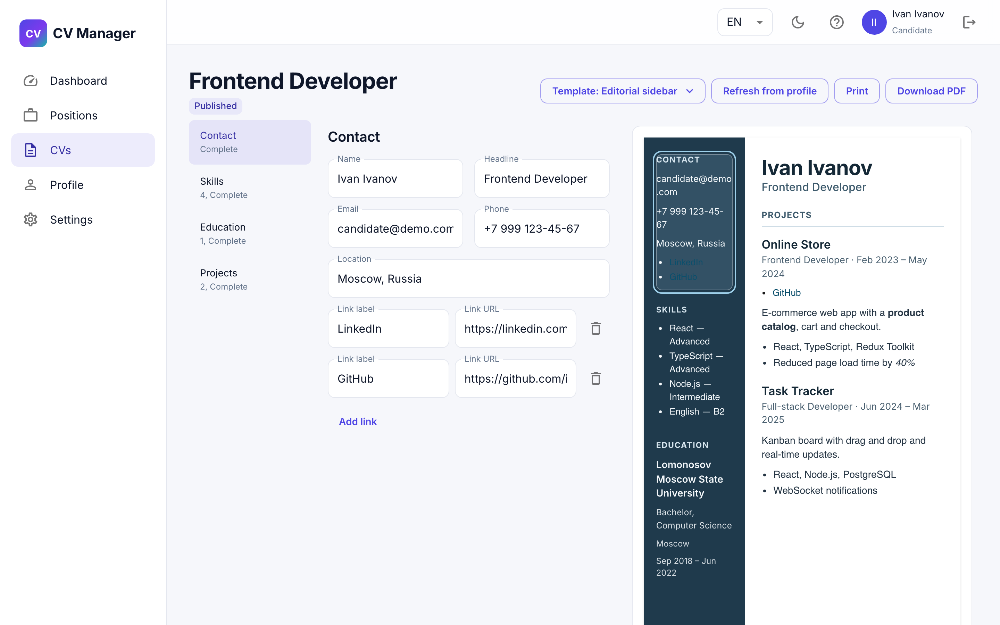
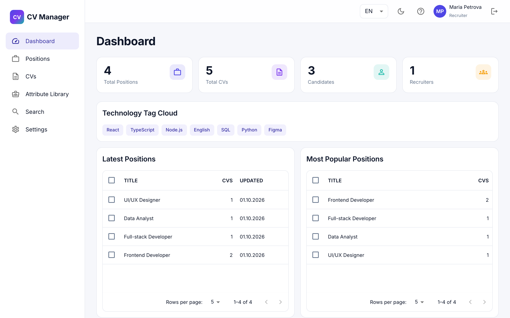
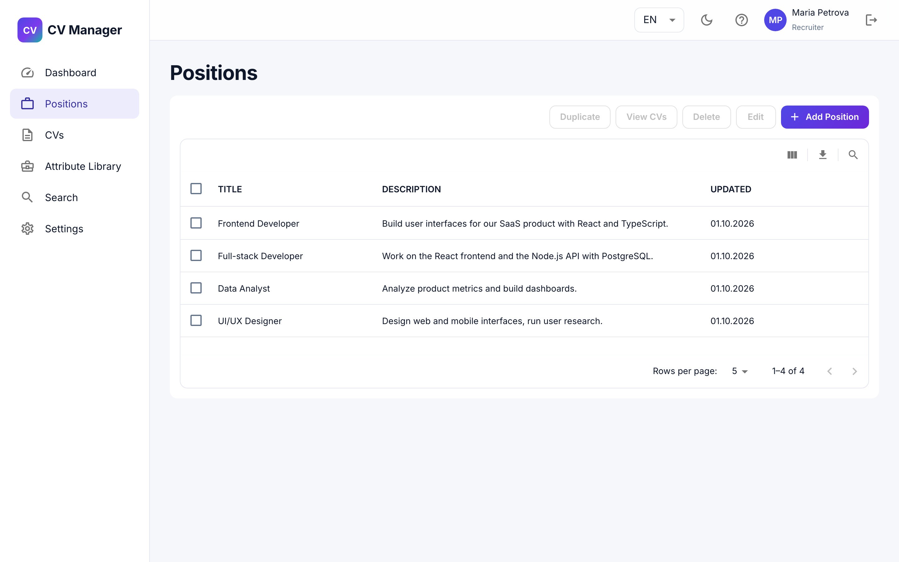
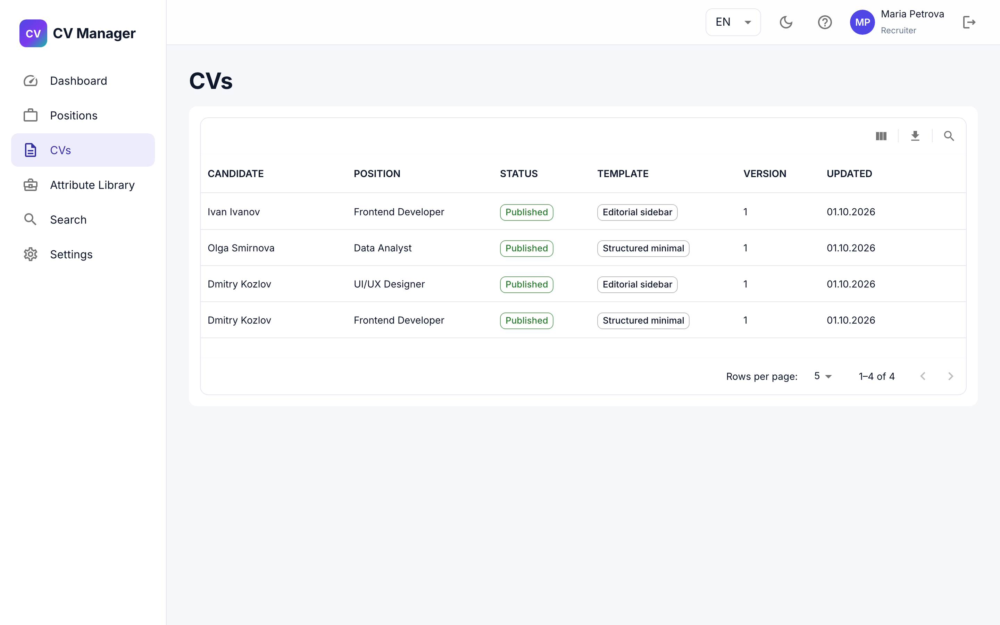
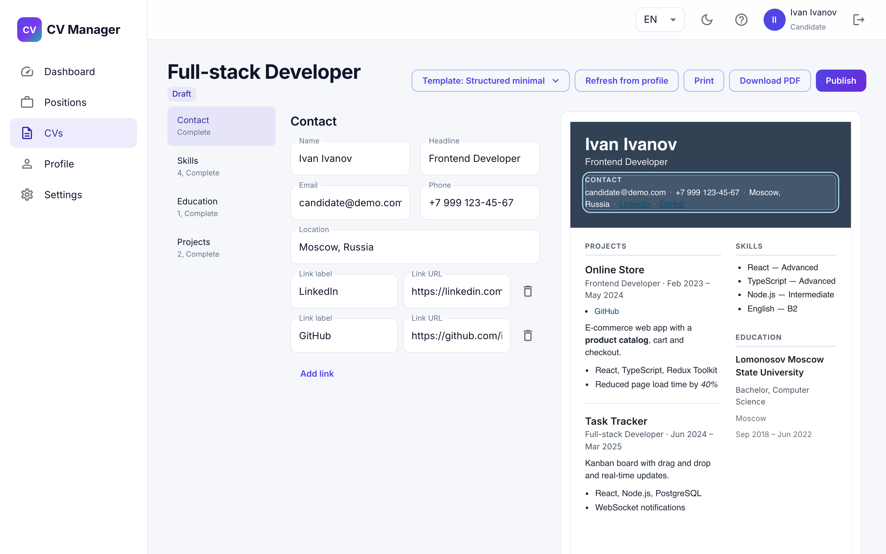
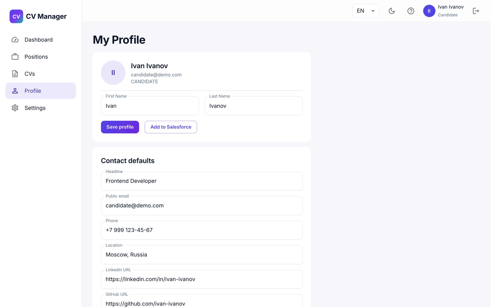
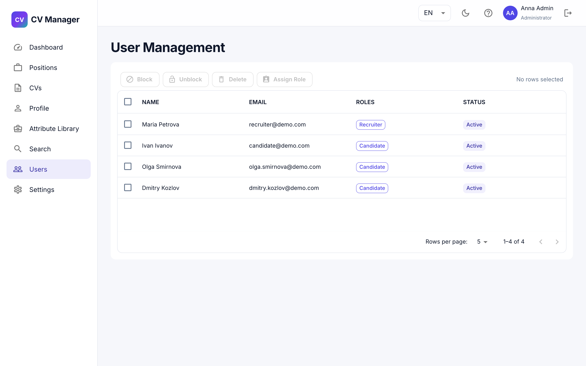
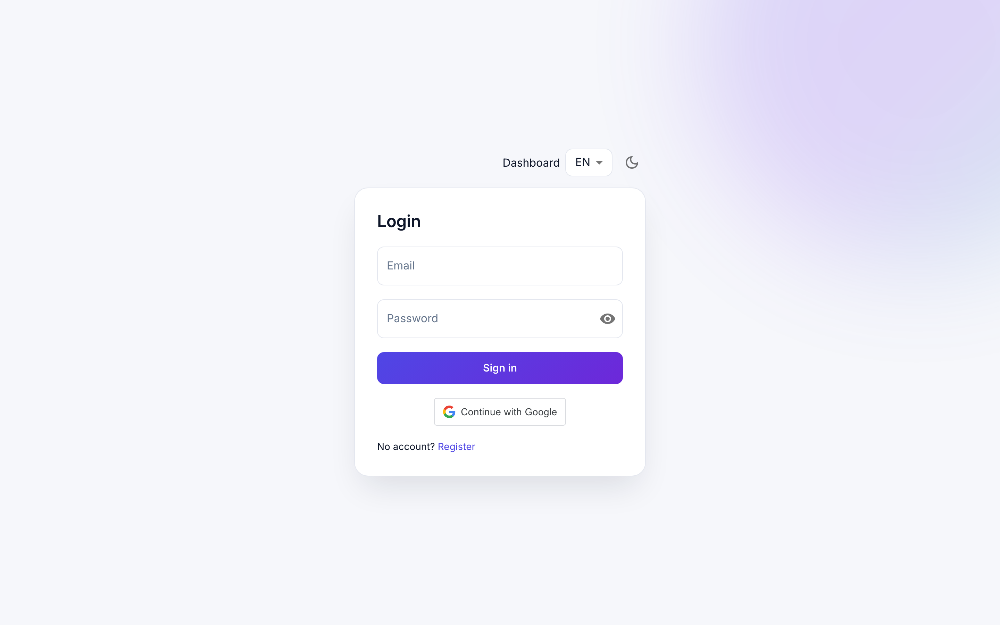
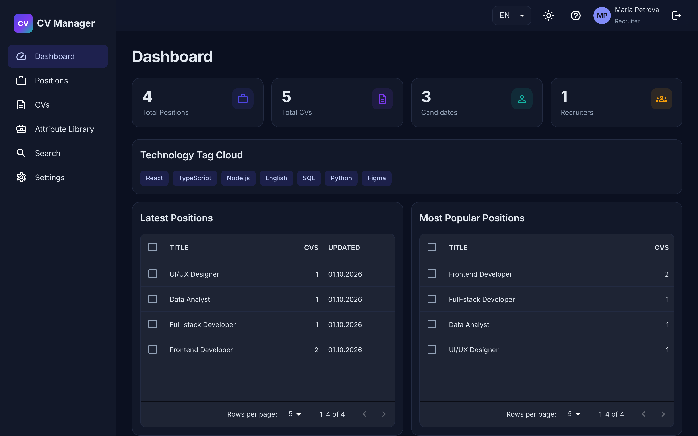
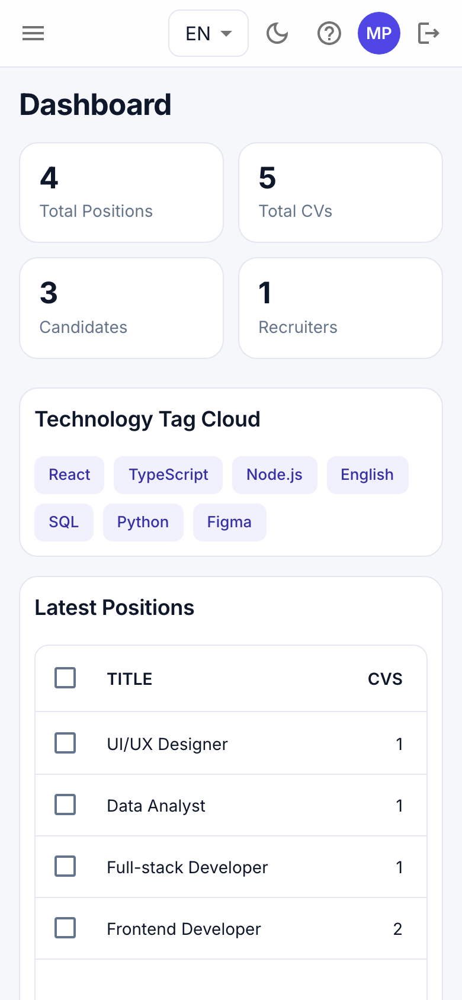

# CvManager

A full-stack web app for building and managing CVs. Candidates keep one profile (contacts, skills, education, projects) and generate CVs from it. Recruiters publish positions and review the CVs sent to them. The CV editor shows a live preview and exports the CV as an A4 PDF.

**Live demo:** https://cvmanager-ousk.onrender.com



## Demo accounts

| Role | Email | Password | What to try |
|---|---|---|---|
| Candidate | `candidate@demo.com` | `Demo1234!` | Edit the profile, open a CV, switch templates, download the PDF |
| Recruiter | `recruiter@demo.com` | `Demo1234!` | Browse the dashboard, manage positions, review published CVs |
| Admin | `admin@demo.com` | `Demo1234!` | Manage users: assign roles, block and unblock accounts |

The demo runs on a free plan, so the first page load after a pause can take about a minute.

## Highlights

- **One source of truth for CVs.** Each CV stores a snapshot of the profile. A candidate can refresh a single section (contacts, skills, education or projects) from the profile without losing edits in the others.
- **PDF in the browser.** The CV is exported with `@react-pdf/renderer` on the client, so the server does not need a headless browser. The preview and the PDF use the same data.
- **Role-based access.** Three roles with checks on every API route. Recruiters only see published CVs, and blocked users are rejected even with a valid token.
- **Safe user content.** Markdown in project descriptions is validated with Zod on the server: HTML tags and non-http links are rejected.
- **TypeScript end to end.** Both the React client and the Express API are written in strict TypeScript. Sequelize models are typed, and the CV content type is inferred from the same Zod schema that validates requests.
- **Responsive and themed.** A custom MUI theme with light and dark modes, layouts for phone, tablet and desktop, checked in Chrome, Firefox and Safari.
- **Tested and containerized.** Vitest tests for the client and the server, and Docker Compose to run the whole app with one command.

## Screenshots

| Recruiter dashboard | Positions |
|---|---|
|  |  |

| Published CVs (recruiter view) | Second CV template |
|---|---|
|  |  |

| Candidate profile | User management (admin) |
|---|---|
|  |  |

| Sign in | Dark theme |
|---|---|
|  |  |

<p align="center">
  
</p>

## Features

**Candidates**
- A profile with contacts, skills, education and projects. Every CV is built from this profile.
- Multiple CVs, each with its own template, and each can be refreshed from the latest profile data.
- A CV editor with a live preview. Project descriptions are written in Markdown.
- Client-side PDF export (A4, selectable text).
- Draft and published CV statuses.

**Recruiters**
- Create and manage positions and their required skills.
- View the CVs submitted for each position (only published CVs are visible).
- Search CVs by skill and a shared skill library.

**Admins**
- User management: assign roles, block and unblock users, delete accounts.

**General**
- English and Russian interface.
- Light and dark themes.
- Dashboard with position stats and a skills tag cloud.
- Support tickets saved to Dropbox and Salesforce contact sync.

## Authentication

- **Email and password.** After sign-up the user receives an email with an activation link. Passwords are hashed with bcrypt.
- **Sign in with Google.** The server verifies the Google token. If no user has this email yet, a candidate account is created and activated automatically.
- Sessions use a JWT that is valid for 24 hours. Blocked users cannot sign in.
- Roles: `CANDIDATE`, `RECRUITER`, `ADMIN`. The API checks the role on every protected route.

## CV templates

| Template | Layout |
|---|---|
| `editorial-sidebar` | Dark sidebar with contacts and skills, main column with projects |
| `structured-minimal` | Header band and a two-column body |

The web preview and the PDF are rendered from the same `CvContent` snapshot, so both always show the same content. The CV page stays light in both app themes.

Project descriptions support **bold**, *italic*, unordered lists and links. Raw HTML is rejected.

## Tech stack

| | |
|---|---|
| **Frontend** | React 19, TypeScript, Vite, MUI, React Router, Zustand, React Hook Form + Zod, i18next, @react-pdf/renderer |
| **Backend** | Node.js, TypeScript, Express 5, Sequelize, PostgreSQL, Zod, JWT, bcrypt, Nodemailer, Google OAuth |
| **Integrations** | Salesforce (jsforce), Dropbox |
| **Tooling** | Vitest, Testing Library, ESLint, Docker Compose |

## Project structure

```
client/     React app: features/ (pages by domain), shared/, store/, routes/
server/     Express API: routes/, controllers/, models/, service/, middleware/, types/
```

In production the Express server also serves the built frontend from `dist/`, so the whole app runs as one service. The demo is hosted on Render with a PostgreSQL database on Supabase.

## Getting started

### Quick start with Docker

```bash
docker compose up -d --build
docker compose exec app npm --prefix server run seed:demo
```

The app runs on http://localhost:4300 with its own PostgreSQL container. The second command fills the database with the demo accounts above, positions and CVs. To use another port, set `APP_PORT`, for example `APP_PORT=5000 docker compose up -d`. Optional settings (SMTP, Google, Salesforce) are read from `server/.env` if the file exists.

### Requirements

- Node.js 20+
- PostgreSQL

### Install

```bash
npm install
npm --prefix server install
```

### Environment variables

Copy the example files and fill them in:

```bash
cp .env.example .env
cp server/.env.example server/.env
```

| Variable | Where | Purpose |
|---|---|---|
| `VITE_API_URL` | `.env` | API base URL (`/api` when the server serves the frontend) |
| `VITE_GOOGLE_CLIENT_ID` | `.env` | Google sign-in on the client |
| `DB_HOST`, `DB_PORT`, `DB_NAME`, `DB_USER`, `DB_PASSWORD` | `server/.env` | PostgreSQL connection |
| `SECRET_KEY_ROLE` | `server/.env` | JWT signing key |
| `SMTP_HOST`, `SMTP_PORT`, `SMTP_USER`, `SMTP_PASSWORD` | `server/.env` | Activation emails |
| `API_URL`, `CLIENT_URL` | `server/.env` | Public URLs used in email links |
| `GOOGLE_CLIENT_ID` | `server/.env` | Google token verification |
| `SF_CLIENT_ID`, `SF_CLIENT_SECRET` | `server/.env` | Salesforce integration (optional) |
| `DROPBOX_ACCESS_TOKEN` | `server/.env` | Support tickets (optional) |

Database tables are created automatically on server start.

### Run in development

```bash
# API on http://localhost:4200, restarts on changes
npm --prefix server run dev

# Web app on http://localhost:5173
npm run dev
```

### Production build

```bash
npm run build                    # client -> dist/
npm --prefix server run build    # server -> server/dist/
npm --prefix server start
```

### Tests

```bash
npm test          # watch mode
npm run test:run  # single run
```

Vitest runs two projects: `client` (jsdom) and `server` (node). The tests cover role and token checks, the API error handler, CV content validation (HTML and unsafe links are rejected, date ranges), building a CV snapshot from a profile, and client utilities.

To run the demo seed integration test against local PostgreSQL:

```bash
docker compose up -d db
CV_SEED_INTEGRATION=1 npm run test:run
```

The test creates and removes its own temporary database. It uses the Compose PostgreSQL connection by default. Override it with `DB_HOST`, `DB_PORT`, `DB_USER` and `DB_PASSWORD` if needed. The database user needs permission to create databases.

### Other scripts

```bash
npm run lint                                   # ESLint for the client and the server
npm --prefix server run typecheck              # type-check the server
npm --prefix server run seed:demo              # add missing demo users, positions and CVs
npm --prefix server run set-role <email> ADMIN # change a user's role (no arguments lists users)
npm --prefix server run backfill:cv-snapshots  # one-time migration of old CV rows, safe to re-run
```

The last three scripts run the compiled server code, so run `npm --prefix server run build` first.
